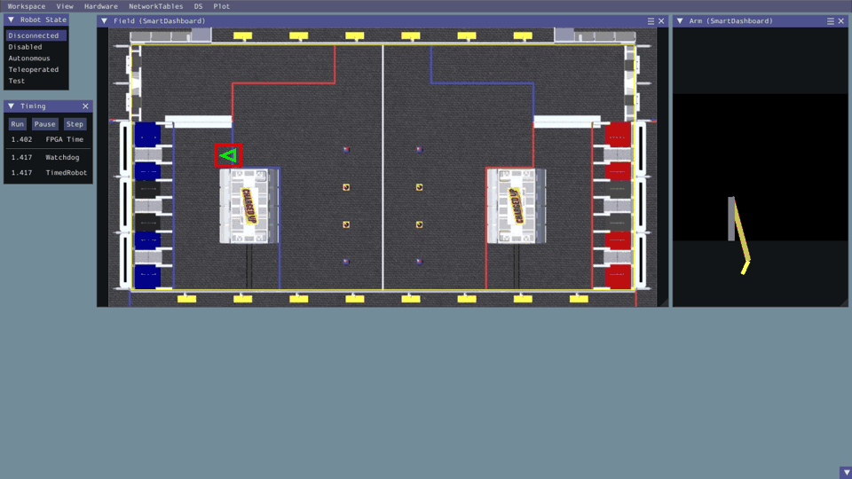

<div align="center">

# 🤖 FRC 2023 · Charged Up Robot Yazılımı

**EGAL Robotics takımının FIRST Robotics Competition 2023 robotu için yazdığım robot kodu: diferansiyel sürüş, tek eksenli kol, tutucu ve otonom rutin. WPILib fizik simülasyonunda bilgisayarda çalıştırılabilir.**




<sub>Otonom rutin WPILib simülatöründe: kol kalkıyor, robot grid'e sürüp oyun parçasını bırakıyor, sonra geri çekilerek community bölgesinden çıkıyor.</sub>

</div>

## Yarışma hakkında
**FIRST Robotics Competition (FRC)**, lise takımlarının 6–8 haftada yaklaşık 50 kg'lık bir yarışma robotu tasarlayıp ürettiği uluslararası bir robotik yarışmasıdır. Her sezon oyun ve görev tamamen değişir.

**2023 sezonunun oyunu: Charged Up**
- Robotlar **küp ve koni** şeklindeki oyun parçalarını alıp sahanın iki ucundaki **grid** adı verilen raflara (alt, orta, üst seviye) yerleştirir.
- Maç 15 saniyelik **otonom** bölümle başlar. Bu bölümde robot sürücü olmadan, yalnızca önceden yazılmış kodla hareket eder.
  - Grid'e parça bırakmak puan getirir.
  - Başlangıç bölgesinden (community) çıkmak da puan getirir.
- Ardından sürücülerin kumandayla yönettiği **teleop** bölümü gelir.
- Maç sonunda robotlar dengelenmesi gereken bir **şarj istasyonuna** çıkmaya çalışır.

## Robot
- **Sürüş:** İki tarafta PWM Spark MAX motor sürücüleriyle tank (diferansiyel) şasi.
- **Kol:** Oyun parçasını grid seviyesine kaldıran **tek eksenli kol** (yükseklik ayarı). Kolu kaldıran ve geri çeken iki motorla sürülür.
- **Tutucu (el):** Kolun ucunda, oyun parçasını kavrayıp bırakmak için **açılıp kapanan ayrı bir motor**.

## Yazılım
- **Otonom (`autonomousPeriodic`)**
  - Zaman tabanlı bir adım dizisi uygulanır: kolu geri çek, kaldır, sabitle, grid'e sür, kolu indir, tutucuyu aç, kolu kaldır, geri çekilerek bölgeden çık.
  - Her adım bir öncekinin bitiş süresine eklenerek tanımlanır, böylece süreler tek yerden ayarlanabilir.
- **Teleop (`teleopPeriodic`)**
  - Gamepad ile arcade sürüş.
  - Bumper tuşlarıyla **hassas ve hızlı sürüş modları**: ileri/dönüş katsayıları ve kol hızı değişir.
  - Tetiklerle kol kontrolü yapılır. Kol, yerçekimine karşı sabit bir **tutma voltajı** (≈3,25 V) ve üzerine eklenen hız komutuyla sürülür.
  - Butonlarla tutucu açılıp kapatılır, kol kilitlenir veya bırakılır; POV tuşlarıyla ince ayar yapılır.
- **Simülasyon (`RobotSim.java`):** Robot kodunun bilgisayarda çalışabilmesi için sonradan ekledim. Robot mantığına dokunmadan PWM çıkışlarını fizik modellerine bağlar:
  - `DifferentialDrivetrainSim`: şasi,
  - `SingleJointedArmSim`: yerçekimli kol,
  - `Field2d` ve `Mechanism2d`: saha ve kol görselleştirmesi.

## Simülasyonda çalıştırma
Gereken: **JDK 17**. WPILib bağımlılıklarını GradleRIO kendisi indirir.
```powershell
git clone https://github.com/AhmetEminArslanbas/frc-2023-robot
cd frc-2023-robot
$env:FRC_AUTO_DEMO = "1"   # otonomu 4 sn sonra kendiliğinden başlatır
.\gradlew simulateJava
```
Açılan simülatör penceresinde saha ve kol mekanizması görünür. `FRC_AUTO_DEMO` verilmezse mod (Autonomous/Teleoperated) sol üstteki **Robot State** panelinden seçilir. Klavye, sanal joystick olarak kullanılabilir.

## Neler öğrendim
- Gerçek bir takım ortamında, kısıtlı sürede çalışan robot yazılımı geliştirmek.
- WPILib'in zamanlı robot (`TimedRobot`) yapısı ve sürüş kütüphaneleri.
- Yazılımı fizik simülasyonuyla donanımdan bağımsız test edilebilir hale getirmek.

---
<sub>Ahmet Emin Arslanbaş · EGAL Robotics. `Main.java` ve şablon kısımları WPILib (BSD lisansı) kaynaklıdır.</sub>
